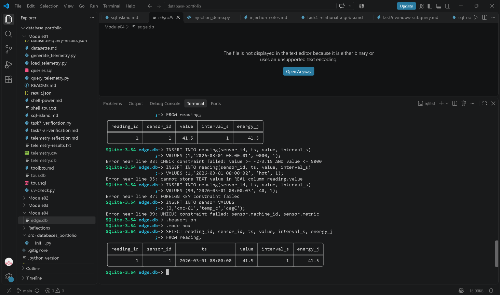

# Module04 — Task 1: Constraint Evidence

`setup.sql` defines strict sensor and reading tables, a generated `energy_j`, range and positive-interval checks, foreign keys, unique sensor/metric and sensor/timestamp keys, and an immutable audit table. The screenshot is retained as visual evidence of the original constraint exercise.

`verify_constraints.py` reproduces the checks against a disposable database without opening or altering `edge.db`. Its latest run observed:

- A valid reading produced `energy_j = 41.5`.
- Out-of-range value rejected by `CHECK`.
- Text stored in the strict `REAL` column rejected.
- Unknown sensor rejected by the foreign key.
- Duplicate machine/metric and duplicate sensor/timestamp rejected by unique constraints.
- Updating a reading produced one audit row; updating or deleting that audit row was rejected.
- `PRAGMA foreign_key_check` returned no rows.

Run `python Module04/verify_constraints.py` from the repository root.

## Screenshot Evidence

