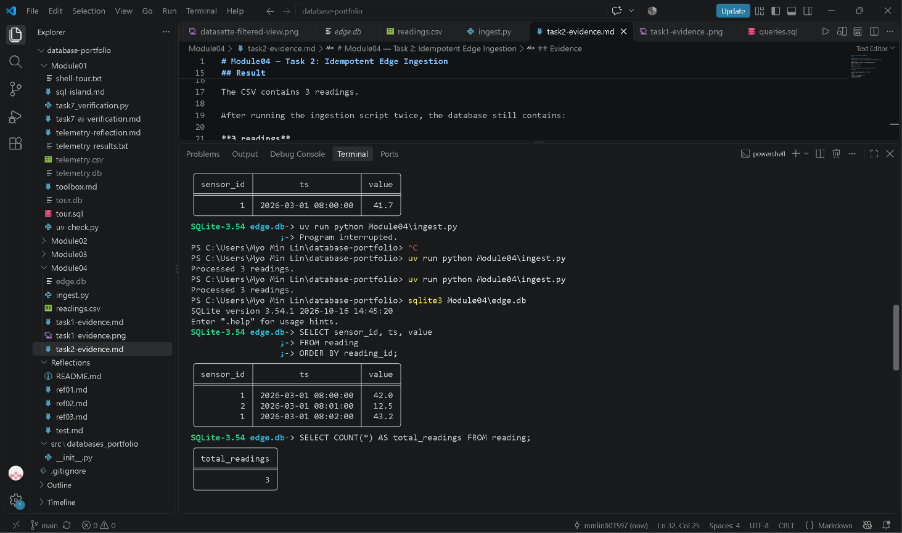

# Module04 — Task 2: Idempotent Edge Ingestion

## UPSERT implementation

`setup.sql` creates a prior temperature value of **41.7** for sensor 1 at `2026-03-01 08:00:00`. The CSV contains the same sensor/timestamp with value **42.0**, plus two new readings. `ingest.py` uses `(sensor_id, ts)` as the unique key and only updates when the incoming value differs. The second replay therefore does not add rows or create a no-op audit update.

## Reproducible result

The ingestion script was run twice against a temporary database created from `setup.sql`:

- Reading count after both runs: **3**
- Alarm count: **1** (the CSV's vibration reading exceeds the trigger threshold)
- Foreign-key check: **0 errors**
- The replayed first reading ends at **42.0**

The test database was temporary; the existing `edge.db` was not changed. Reproduce with `python Module04/ingest.py --db <temporary-db>` after creating that database from `setup.sql`.

## Screenshot Evidence

The screenshot is retained as historical visual evidence; the script and setup file above provide the repeatable check.
