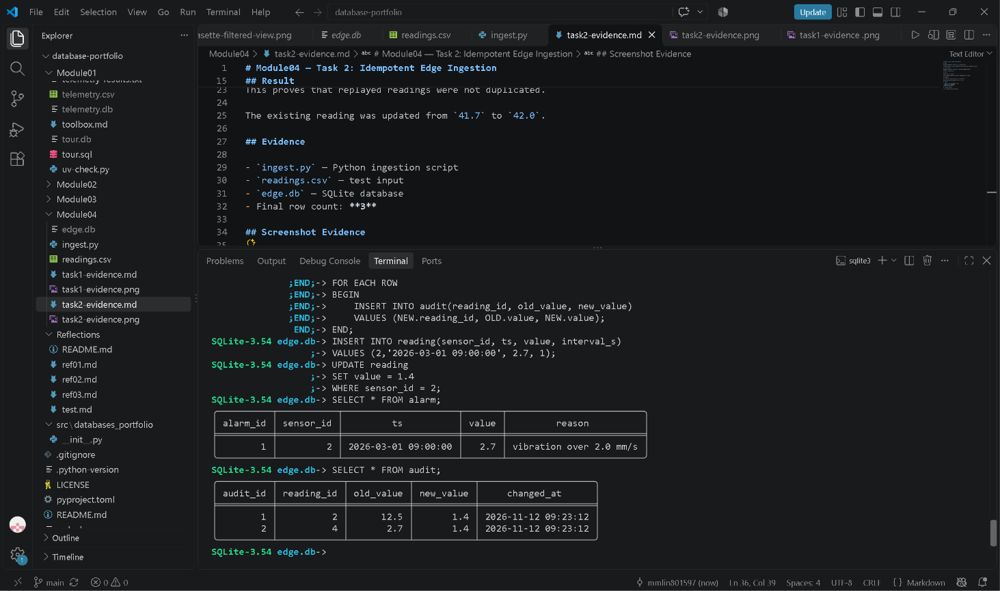

## Trigger Cost Measurement

I measured the time required to ingest 10,000 readings with and without the vibration alarm trigger.

| Configuration | Time for 10,000 rows |
|---|---:|
| Without alarm trigger | 19.97 ms |
| With alarm trigger | 38.56 ms |

The alarm trigger increased the measured ingestion time by about 18.59 ms.

This shows that triggers add some write overhead because SQLite performs the additional trigger action for each matching row.

## Screenshot Evidence

