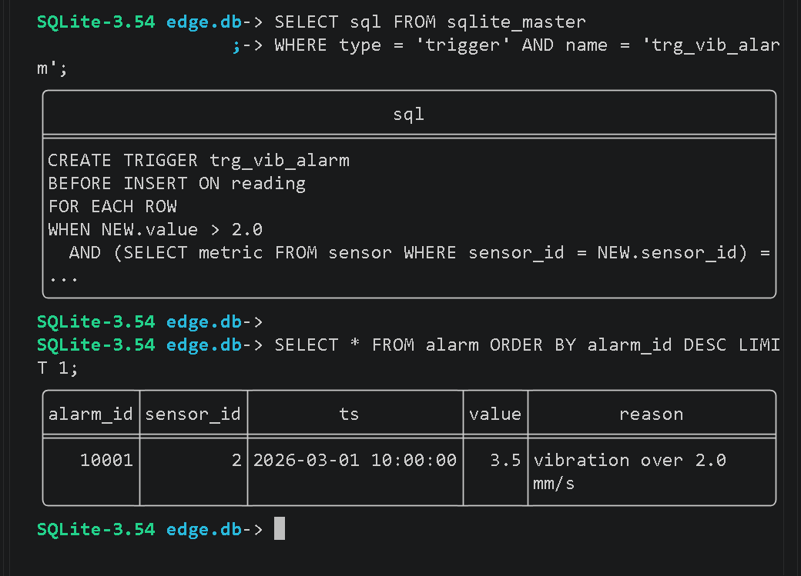

# Module04 — Task 5: Break Your Own Alarm

`task5.sql` is a reproducible experiment to run after `setup.sql` in a fresh SQLite database. It replaces the normal `AFTER INSERT` alarm trigger with a `BEFORE INSERT` trigger, inserts a vibration reading at 3.5 mm/s, then displays the stored reading and alarm.

The alarm table records sensor, time, value, and reason; it does not require a foreign key to a reading row. That is why this simple side effect can be produced before the reading is stored. In a real design, decide whether an alarm should reference a reading identifier; a `BEFORE INSERT` trigger cannot refer to a row ID that has not yet been persisted. The normal `AFTER INSERT` trigger is clearer when the alarm represents a successfully stored reading.

## Screenshot Evidence
