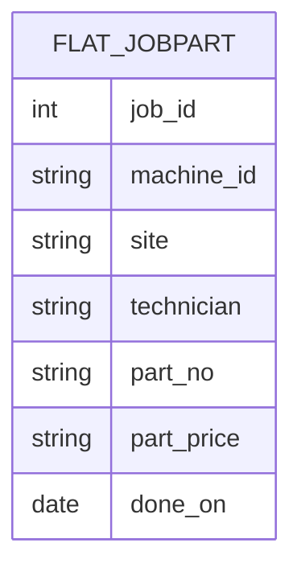
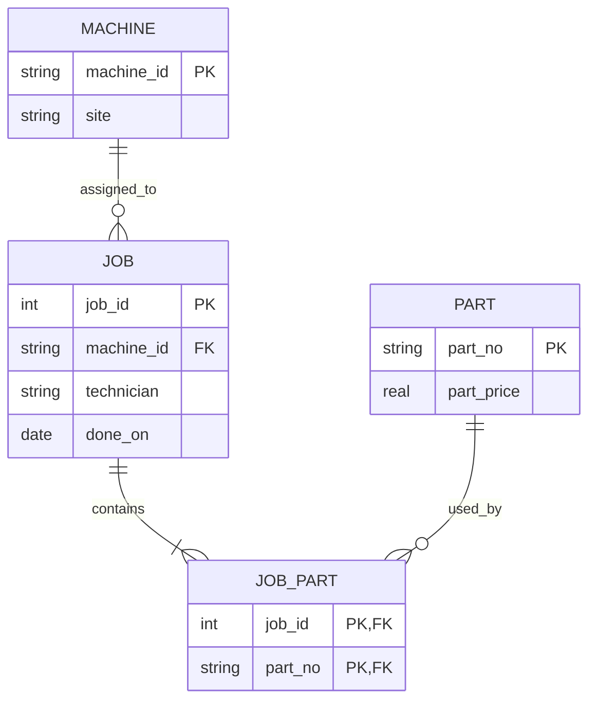

# Module 5 — Normalization Notes

## Relation, assumptions, functional dependencies, and key

The source relation is `flat_jobpart(job_id, machine_id, site, technician, part_no, part_price, done_on)`. Its rows represent one part used by one job. Under the stated business rules:

- `job_id → machine_id, technician, done_on`: a job has one machine, technician, and completion date.
- `machine_id → site`: a machine is assigned to one site.
- `part_no → part_price`: a part number identifies its current listed price.
- `(job_id, part_no)` is the candidate key for a job-part row; neither component alone identifies that row.

These are domain assumptions supplied by the exercise, not facts proven for every possible dataset. A five-row sample only demonstrates observed agreement. In particular, if a job can have multiple technicians or if prices are historical per transaction, the dependencies/schema need revision.

## Two ER sketches

### Flat relation as stored



Each row repeats job, machine, and part facts. The composite candidate key is `(job_id, part_no)`.

### Decomposed design



`JOB_PART` resolves the many-to-many relationship between jobs and parts. The minimum-one-part marker reflects the generated workload; a production model may permit jobs before parts are assigned.

## Normal forms

- **1NF:** one atomic part number and price per row; no comma-separated part list. The supplied relation meets this condition when each row is one job-part occurrence.
- **2NF:** with key `(job_id, part_no)`, remove dependencies on only part of that key. `part_no → part_price` moves to `part`; job-level attributes move to `job`.
- **3NF:** remove non-key-to-non-key dependencies. `machine_id → site` moves to `machine`, avoiding site repeated across jobs.

The resulting `machine`, `part`, `job`, and `job_part` tables are defined in `setup.sql`.

## Anomalies in the five-row example

The statements below are examples for a disposable `flat5` table. The benchmark runner executes them only in its temporary database; no portfolio database is changed.

```sql
CREATE TABLE flat5 (
    job_id INTEGER, machine_id TEXT, site TEXT,
    technician TEXT, part_no TEXT, part_price REAL
);
INSERT INTO flat5 VALUES
    (1, 'cnc-01', 'Gütersloh', 'tech-0', 'P-0001', 6.00),
    (1, 'cnc-01', 'Gütersloh', 'tech-0', 'P-0002', 7.00),
    (2, 'cnc-02', 'Gütersloh', 'tech-1', 'P-0001', 6.00),
    (2, 'cnc-02', 'Gütersloh', 'tech-1', 'P-0003', 8.50),
    (3, 'cnc-01', 'Gütersloh', 'tech-0', 'P-0003', 8.50);

-- Update anomaly: all rows for cnc-01 must change together.
UPDATE flat5 SET site = 'Bielefeld' WHERE machine_id = 'cnc-01';
-- Two sessions updating different copies can leave contradictory site values.

-- Insert anomaly: a part with no job cannot be represented without a fake job.
-- In flat5's permissive example this can only be represented as an invalid
-- placeholder row with missing job facts, not as an independent part record.
INSERT INTO flat5 VALUES (NULL, NULL, NULL, NULL, 'P-0004', 9.25);
-- In the normalized design, this fact has an independent home:
INSERT INTO part(part_no, part_price) VALUES ('P-0004', 9.25);

-- Delete anomaly: deleting the only job row containing P-0002 also loses its price.
DELETE FROM flat5 WHERE job_id = 1 AND part_no = 'P-0002';
```

The normalized design stores machine site once, allows a part to exist without a job, and retains part facts independently of job-part rows.

In the executed example, the update touched 3 rows. The flat table accepted the insert only as a placeholder with a NULL job ID and NULL job facts; the normalized `part` table accepted a standalone part with no job-part row. Deleting the sole `P-0002` occurrence removed its flat-table price, while the normalized `part` record remained. The runner prints these counts when reproduced.
